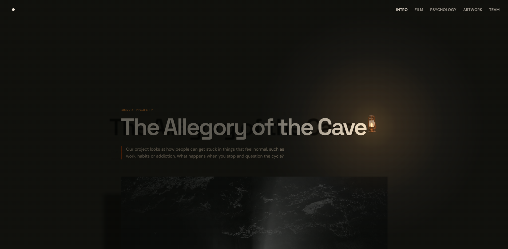

<div align="center">
  <h1>The Allegory of the Cave</h1>
  <p>An interactive reinterpretation of Plato's allegory for CIM220 Project 2.</p>
  <p>
    <a href="https://docs.google.com/document/d/1Tbfb3tGZK9Adgww43f8-259KkZWe2DzW6KcXMTVv4PE/edit?tab=t.0">Project documentation</a>
    ·
    <a href="#getting-started">Run locally</a>
  </p>
</div>



## Contents

- [About the project](#about-the-project)
- [Getting started](#getting-started)
- [How to explore](#how-to-explore)
- [Project structure](#project-structure)
- [Build and deploy](#build-and-deploy)
- [Team and credits](#team-and-credits)

## About the project

The project looks at how people can get stuck in patterns that feel normal, such as work, habits, or addiction. The website invites visitors to explore that idea by carrying a lantern through a cave.

- Scrolling moves the camera through a 3D cave entrance.
- Inside, the lantern travels between headings and photographs. Its light casts shadows and reveals a second photograph within the first cave image.
- Visitors can move the lantern with a mouse, touch, or keyboard.

### Tech stack

| Tool | Role |
| --- | --- |
| HTML, CSS, and JavaScript | Page structure, styling, and interaction |
| Three.js | Cave and lantern rendering, lighting, and image reveal shader |
| GSAP | Lantern motion and animation timing |
| Lenis | Smooth scrolling and section navigation |
| Vite | Local development and production builds |
| Blender | Lantern modelling and GLB export |

## Getting started

Use Node.js 24 and npm to match the GitHub Actions build. In the folder containing `package.json`, run the following commands.

```sh
npm ci
npm run dev
```

Open the URL Vite prints in the terminal. Press Ctrl+C to stop the server.

## How to explore

Pick up the lantern to brighten the cave entrance, then scroll to move inside. On a touch screen, release the lantern before swiping to scroll. Drag the lantern over the first cave photograph to reveal the second image. Releasing the lantern sends it back to its current orbit.

To use the keyboard, focus the lantern and press Enter or Space to pick it up. Move with the arrow keys and hold Shift for larger steps. Press Enter, Space, or Escape to release it.

## Project structure

| Path | What to edit |
| --- | --- |
| [`index.html`](index.html) | Page copy, sections, images, and captions |
| [`src/main.js`](src/main.js) | Browser entry point and loading lifecycle |
| [`src/page/`](src/page/) | Navigation, scroll settings, and heading sizing |
| [`src/cave/`](src/cave/) | Cave camera, lighting, and entrance transition |
| [`src/lantern/`](src/lantern/) | Dragging, orbit stops, 3D rendering, and page lighting |
| [`src/styles/`](src/styles/) | Colours, layout, and feature styles |
| [`src/assets/`](src/assets/) | Optimised models and icons bundled with the site |
| [`artwork/`](artwork/) | Editable 3D sources and texture files |

### Update artwork and effects

- To replace a reveal image, edit the visible image's `src` and its hidden image's `data-reveal-src` in `index.html`, then update both photo credits.
- Adjust orbit timing and page lighting in `src/lantern/experience.js`. Adjust orbit clearance in `src/lantern/stops.js` and the 3D key light in `src/lantern/stage.js`.
- After editing `artwork/lantern.blend`, extract `artwork/textures.rar` into `artwork/` if needed. Run the export script from the project folder with Blender on your PATH. The script writes `src/assets/lantern.glb`.

```sh
blender --background --python scripts/export-lantern.py
```

## Build and deploy

```sh
npm run build
npm run preview
```

Vite writes the production build to `dist/`. The [GitHub Pages workflow](.github/workflows/pages.yml) builds with the `/cim220-project-2/` base path and publishes `dist/` on pushes to `main`. The workflow also supports manual runs from the Actions tab. In the repository's Pages settings, set the deployment source to **GitHub Actions**.

## Team and credits

| Team member | Contribution |
| --- | --- |
| Nikos Vasilellis | Story and script |
| Emily Ryan | Story edit, shot map, and visual direction |
| Kobie Wildermoth | Website and structure |
| Brodey Bright | Assets, animation, and visual design |

- The cave model is a simplified export of [Sea Cave 3 by b_nealie](https://sketchfab.com/3d-models/sea-cave-3-ce71dc2848984acfb11d8002a48a6043), licensed under [CC BY 4.0](https://creativecommons.org/licenses/by/4.0/).
- Cave photographs by [Mohammad Alizade](https://unsplash.com/es/fotos/una-persona-parada-en-la-cima-de-una-roca-bajo-una-luz-SxigExTctZY), [Alec Krum](https://unsplash.com/photos/a-light-in-a-cave-50N-igfAvxM), and [Daniel Lincoln](https://unsplash.com/fr/photos/personne-a-linterieur-de-la-grotte-W15xHUkGbuA) on Unsplash.
- The image reveal was inspired by [DenDionigi's CodePen](https://codepen.io/DenDionigi/pen/YzOZxeR).
- README structure adapted from [Louis3797's Awesome README Template](https://github.com/Louis3797/awesome-readme-template).
